<a href="https://dogogod.github.io"><picture><source media="(prefers-color-scheme: dark)" srcset="./assets/readme/hero-dark.svg"><source media="(prefers-color-scheme: light)" srcset="./assets/readme/hero-light.svg"></picture></a>

<picture><source media="(prefers-color-scheme: dark)" srcset="./assets/readme/section-work-dark.svg"><source media="(prefers-color-scheme: light)" srcset="./assets/readme/section-work-light.svg"></picture>

  <a href="https://github.com/DOGOGOD/AutoOdom"><picture><source media="(prefers-color-scheme: dark)" srcset="./assets/readme/card-01-dark.svg"><source media="(prefers-color-scheme: light)" srcset="./assets/readme/card-01-light.svg"></picture></a>
  <a href="https://github.com/DOGOGOD/SJTUClaw"><picture><source media="(prefers-color-scheme: dark)" srcset="./assets/readme/card-02-dark.svg"><source media="(prefers-color-scheme: light)" srcset="./assets/readme/card-02-light.svg"></picture></a>

  <a href="https://github.com/DOGOGOD/HomeLetters"><picture><source media="(prefers-color-scheme: dark)" srcset="./assets/readme/card-03-dark.svg"><source media="(prefers-color-scheme: light)" srcset="./assets/readme/card-03-light.svg"></picture></a>
  <a href="https://github.com/DOGOGOD/DOGOGOD.github.io"><picture><source media="(prefers-color-scheme: dark)" srcset="./assets/readme/card-04-dark.svg"><source media="(prefers-color-scheme: light)" srcset="./assets/readme/card-04-light.svg"></picture></a>

  <a href="https://github.com/DOGOGOD/SJTU-Sync"><picture><source media="(prefers-color-scheme: dark)" srcset="./assets/readme/card-05-dark.svg"><source media="(prefers-color-scheme: light)" srcset="./assets/readme/card-05-light.svg"></picture></a>
  <a href="https://github.com/DOGOGOD/MineSweeper"><picture><source media="(prefers-color-scheme: dark)" srcset="./assets/readme/card-06-dark.svg"><source media="(prefers-color-scheme: light)" srcset="./assets/readme/card-06-light.svg"></picture></a>

<picture><source media="(prefers-color-scheme: dark)" srcset="./assets/readme/section-tools-dark.svg"><source media="(prefers-color-scheme: light)" srcset="./assets/readme/section-tools-light.svg"></picture>

<picture><source media="(prefers-color-scheme: dark)" srcset="./assets/readme/toolkit-dark.svg"><source media="(prefers-color-scheme: light)" srcset="./assets/readme/toolkit-light.svg"></picture>

<a href="https://dogogod.github.io"><picture><source media="(prefers-color-scheme: dark)" srcset="./assets/readme/footer-dark.svg"><source media="(prefers-color-scheme: light)" srcset="./assets/readme/footer-light.svg"></picture></a>

